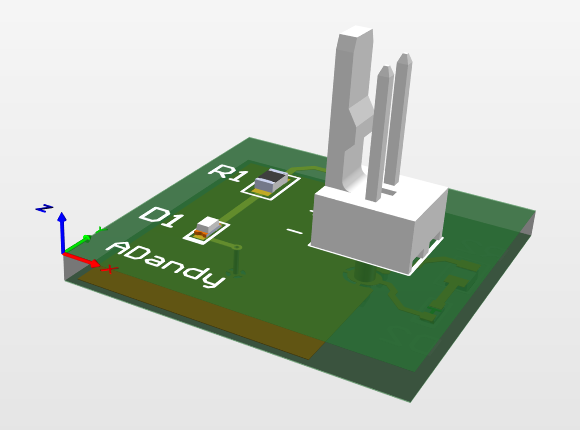
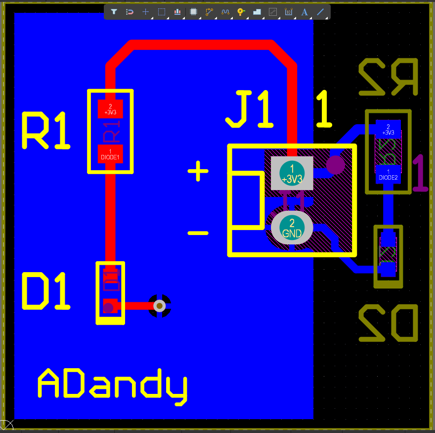
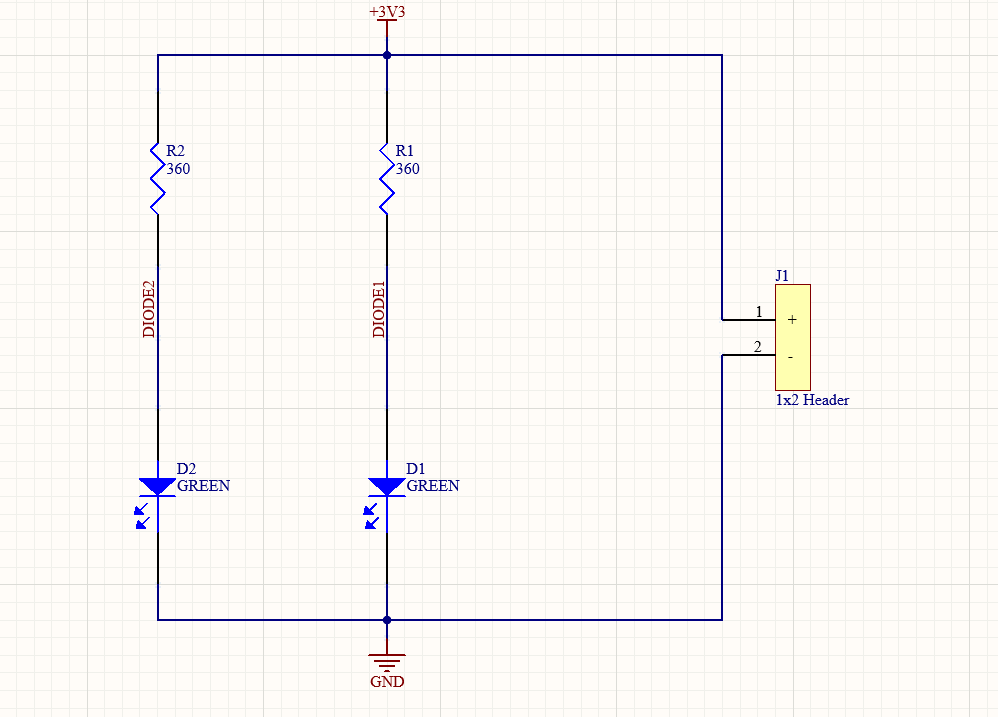

# 01 · Placa LED — tutorial de Altium (FEDEVEL)

Mi primera placa en Altium Designer, hecha de punta a punta siguiendo el tutorial de **Robert Feranec**: [Altium Designer 22 Tutorial – Quick & Easy](https://www.youtube.com/watch?v=PqFtSpAXB9Q). El video usa AD22; yo lo hice en **AD26**.

  
  

  

## La placa

- **20 × 20 mm**, 2 capas, 1.6 mm de grosor.
- Un header de 2 pines (`+3V3`, `GND`) alimenta **dos LEDs verdes**, cada uno con su resistencia de 360 Ω. Uno va en la cara de arriba y el otro en la de abajo.
- Plano de **GND** (polygon pour) en la capa de abajo, unido a la cara de arriba con una via *tented*.

## Componentes (BOM)

| Ref. | Cant. | Parte | Fabricante | DigiKey | Footprint |
|---|---|---|---|---|---|
| R1, R2 | 2 | Resistencia 360 Ω 1 % 0805 | Yageo `AC0805FR-07360RL` | `13-AC0805FR-07360RLCT-ND` | R0805 |
| D1, D2 | 2 | LED verde 0603 | VCC `LSM0603453V` | `LSM0603453VCT-ND` | LED0603G |
| J1 | 1 | Header 1×2, 2.54 mm, THT | Molex `22-27-2021` | `WM4111-ND` | HEADER1X2 |

Costo de partes: **≈ 1.05 USD por placa** (DigiKey, Cut Tape, octubre 2026).

Los símbolos y los footprints los hice a mano: los pads salen del *land pattern* de cada fabricante y llevan modelo 3D y capa de assembly.

## Reglas de diseño

| Regla | Valor |
|---|---|
| Clearance | 0.3 mm |
| Ancho de pista | mín. 0.3 · preferido 0.5 · máx. 1 mm |
| Via | diámetro 0.6 mm · hueco 0.3 mm |
| Silk to Solder Mask | 0.1 mm |

El último DRC salió con **0 violaciones** (reporte en `Project Outputs for LED_Youtube/`).

## Archivos

| Archivo / carpeta | Qué es |
|---|---|
| `LED_Youtube.PrjPcb` | Proyecto de Altium (ábrelo primero) |
| `LEd.SchDoc` · `LEd.PcbDoc` | Schematic y layout |
| `Led_Schlib1.SchLib` · `LEd.PcbLib` | Librerías de símbolos y footprints |
| `3D_MODel/` | Modelos STEP de los componentes |
| `LED_Job.OutJob` | Configuración de todas las salidas |
| `Project Outputs for LED_Youtube/` | Gerbers, NC Drill, BOM, Pick and Place, PDFs (schematic, capas 1:1, assembly, 3D) y STEP de la placa |

Para mandarla a fabricar, los **Gerbers + NC Drill** están en un zip en [Releases](../../releases).

## Qué aprendí

- Los pines del símbolo van en el grid de 100 mil (mover y conectar en 100, dibujar en 10).
- El footprint sale del *land pattern* del fabricante de esa parte exacta, en su documento vigente.
- Qué hace cada capa: cobre, máscara (Solder), pasta (Paste), serigrafía (Overlay), assembly y board outline.
- Revisar las violaciones con el DRC y revisar los Gerbers con un visor (ViewMate) antes de fabricar.
- En AD26, la BOM solo trae precio y stock si cada componente tiene **Supplier Links**.

## Créditos

Tutorial y diseño original: **Robert Feranec — FEDEVEL** ([video](https://www.youtube.com/watch?v=PqFtSpAXB9Q) · [proyecto original](https://github.com/FEDEVEL/youtube-altium-quick-tutorial)). Esta es mi versión, hecha siguiendo el video.
