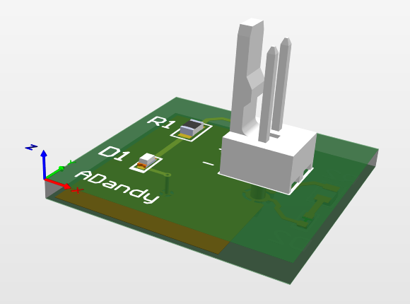

<h1 align="center">pcb-practicas</h1>

  Repo de <b>tutoriales y prácticas</b> de diseño de PCB en Altium Designer. 
  Cada carpeta es un ejercicio completo: librerías → schematic → layout → archivos de fabricación.

  
  
  

  

## Prácticas

| | Práctica | Basada en | Estado |
|:---:|---|---|:---:|
|  | **[01 · Placa LED](01-led-tutorial-fedevel/)** 20 × 20 mm · 2 capas · 2 LEDs | Tutorial de Altium de Robert Feranec ([FEDEVEL](https://www.youtube.com/watch?v=PqFtSpAXB9Q)) | Terminada |
